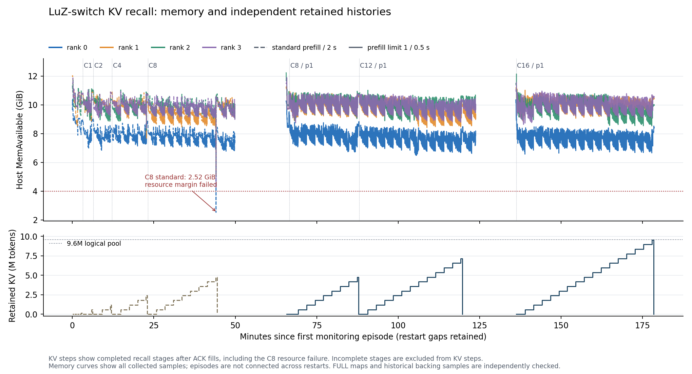

# LuZ-switch 满池 KV 驻留与召回实测

记录更新：2026-10-15T18:39:16.317967+08:00。

**默认服务按使用者最新要求保留 luz-switch B20；hybrid_v2 停止备用。** 原 B20 正式 runtime 已恢复，四 rank 与授权状态已核验。

本轮完成 C1/2/4/8/12/16：C16 满池邻近容量、召回与资源检查通过。

验收对象是 **B20 的数值计算/KV 格式配置 + streaming-session 接口 + 两个明确的会话运行时修正 + 只读探针**；后续内存候选另加 `--prefill-max-requests 1`，保持 MRR16、9.6M 池和客户端多路查询。C1/2/4 属原入场轮；C8 同时保留原轮和 prefill1 复测，C12/16 属 prefill1 候选。原同批 prefill C8 的召回通过，但头节点采样低至 2.52GiB，资源余量未签收。原 B20 生产文件、既有标签与四场景速度资格不扩大。

## 条件与方法

- 四台 GB10，交换机双 rail；实测镜像 `sha256:3aca5abc11376e522c0c72852d2cea3030eab11c45c2555544ce8f21632b894a`，没有改用公开脱敏镜像重测。
- 配置为 600000 总上下文、MRR16、实际 FULL 池 9600000；输入约 596.9k，留出追加问题、输出、投机及页分配余量。600000 不能全部当作输入预算。
- 近满池签收要求 16 条独立流实际输入合计至少达到逻辑池的 99%，并同时通过评分、资源、冷填充、device KV 复用与无 retract；不能由短 C16 smoke 或池初始化代替。
- 公版《三國志演義》背景，每流七条独立随机记录，目标深度 1/10/25/50/75/90/99%；同 key 不同值检测跨会话串值。先 ACK 后查询，问题中不带答案。
- 各级使用独立 session、不同的前置 nonce 防止跨级 prefix hit；容量阶梯沿用同一套随机记录来控制位置/内容变量。这是一次 base seed 的阶梯，不能称为多 seed 泛化。
- 每级先逐流串行冷填充并全部保留，再同时提交 C 路查询；测试的是 C 份长历史同时驻留后的调用，不是 C 路 600k 输入同时提交的 prefill 吞吐，也不是 C16 长输出 decode 速度。
- native API、temperature=0；使用 streaming session 保留 KV，HTTP 响应 `stream=false`。本文“串流”指其他会话值串入，不是 SSE 流式吞吐或断线测试。
- 每级 before/plateau/after-query/closed 均取四 rank 快照；完整页序列独立重建并核对 SHA、别名与 free-list 冲突；历史 backing 每位置抽样最多 1024 bytes。
- `session_held_full_tokens` 只计 tree-protected prefix 之外的尾部，不是整个历史。总持有长度用各 slot committed 与完整映射核实，TP4 不乘四。

## 长度与容量结果

| 阶段 | 独立流 | 输入 token 合计 | 记录正确 | 全部 7/7 的流 | 串值 | 最低可用内存 GiB | 资源签收 |
|---|---:|---:|---:|---:|---:|---:|---|
| smoke2 | 2 | 3,977 | 14/14 | 2/2 | 0 | 8.85 | 通过 |
| smoke16 | 16 | 31,728 | 112/112 | 16/16 | 0 | 8.64 | 通过 |
| baseline32k | 1 | 32,675 | 7/7 | 1/1 | 0 | 7.88 | 通过 |
| baseline128k | 1 | 131,056 | 7/7 | 1/1 | 0 | 7.92 | 通过 |
| c1-seed1 | 1 | 596,945 | 7/7 | 1/1 | 0 | 6.99 | 通过 |
| c2-seed1 | 2 | 1,193,878 | 14/14 | 2/2 | 0 | 6.84 | 通过 |
| c4-seed1 | 4 | 2,387,785 | 28/28 | 4/4 | 0 | 7.13 | 通过 |
| c8-seed1 | 8 | 4,775,645 | 56/56 | 8/8 | 0 | 2.52 | 未通过 |
| smoke16-prefill1 | 16 | 31,728 | 112/112 | 16/16 | 0 | 8.41 | 通过 |
| c8-prefill1-seed1 | 8 | 4,775,645 | 56/56 | 8/8 | 0 | 6.72 | 通过 |
| c12-prefill1-seed1 | 12 | 7,163,474 | 84/84 | 12/12 | 0 | 6.48 | 通过 |
| c16-prefill1-seed1-retry1 | 16 | 9,551,256 | 112/112 | 16/16 | 0 | 6.57 | 通过 |

## 各位置 exact match

| 并发 | 1% | 10% | 25% | 50% | 75% | 90% | 99% |
|---:|---:|---:|---:|---:|---:|---:|---:|
| C1 / 原入场 | 1/1 | 1/1 | 1/1 | 1/1 | 1/1 | 1/1 | 1/1 |
| C2 / 原入场 | 2/2 | 2/2 | 2/2 | 2/2 | 2/2 | 2/2 | 2/2 |
| C4 / 原入场 | 4/4 | 4/4 | 4/4 | 4/4 | 4/4 | 4/4 | 4/4 |
| C8 / 原入场 | 8/8 | 8/8 | 8/8 | 8/8 | 8/8 | 8/8 | 8/8 |
| C8 / prefill1 | 8/8 | 8/8 | 8/8 | 8/8 | 8/8 | 8/8 | 8/8 |
| C12 / prefill1 | 12/12 | 12/12 | 12/12 | 12/12 | 12/12 | 12/12 | 12/12 |
| C16 / prefill1 | 16/16 | 16/16 | 16/16 | 16/16 | 16/16 | 16/16 | 16/16 |

位置是目标深度；实际 token 坐标和比例逐流列于 results.json，不能将短 smoke 的协议/记录开销忽略。严格 JSON 评分拒绝重复 key；漏值、额外 key、格式错误、输出上限和最差流均保留。

## C16 四 rank 驻留与内存

C16 实际输入 **9,551,256 token**（逻辑池 99.492%）；ACK 后四 rank 各自核验同一批 **9,551,288 committed FULL token**。此处是 16 份独立历史，页映射没有靠长 prefix 共享缩减。

| Rank | committed FULL | 独立 FULL 页 | 查询前空闲 FULL token | 最低可用 GiB | 容器 swap bytes | 主机 swap-out KiB | OOM kill 增量 |
|---|---:|---:|---:|---:|---:|---:|---:|
| rank0 | 9,551,288 | 37,312 | 48,128 | 6.57 | 0 | 28 | 0 |
| rank1 | 9,551,288 | 37,312 | 48,128 | 8.88 | 0 | 56 | 0 |
| rank2 | 9,551,288 | 37,312 | 48,128 | 8.53 | 0 | 20 | 0 |
| rank3 | 9,551,288 | 37,312 | 48,128 | 8.64 | 0 | 16 | 0 |

查询设备缓存历史：596,922–596,976 token/流；host cache 为 0。全部旧 FULL 页保持原映射：True。close 后四 rank slot 为 0、request-row 空闲回到 16。

close 释放 session 所有权后，radix 可以保留 evictable 内容，预分配 CUDA pool 也不会立即缩小；不能把这当成仍有 session 被占用。

SWA 单独核对：池 125,440 token；plateau allocator free 3,328，radix evictable 113,920，protected 4,096、session-held tail 4,096。低 free 不等于全部不可回收。查询后 free 4,352；close 后 protected 与 session-held 均归零，但 evictable 仍为 112,896，因此不要求 allocator free 立即等于池总量。本轮未观察到 SWA 停滞，长输出/长追加仍需另测。

plateau 后重置诊断峰值计数，查询窗口实测如下。`prefill-max-requests=1` 限制新 prefill 的批量；running 峰值反映当时真正活动的请求数。CUDA 峰值不能与 Linux MemAvailable 简单相减，也不能替代完整资源曲线。

| Rank | 查询峰值 CUDA allocated GiB | 查询峰值 CUDA reserved GiB | 查询峰值 running |
|---|---:|---:|---:|
| rank0 | 94.90 | 97.05 | 16 |
| rank1 | 94.90 | 97.05 | 16 |
| rank2 | 94.90 | 97.05 | 16 |
| rank3 | 94.90 | 97.05 | 16 |

原轮资源 guard 为 2 秒采样，C8 查询出现一次低于 4GiB 的采样而未达到“连续三次”的中止条件，完整序列复核后仍判资源余量未通过。原 C12 已启动、完成一流填充，第二流在填；发现 C8 低水位后主动中止，未做本级召回，原配置 C16 未运行。候选轮改为 0.5 秒采样，此外每级结束必须逐点复核最低可用量 >=4GiB，未满足不得继续下一级。容器 swap、新 OOM、连续低水位和持续主机换出仍会中止。历史 swap 使用量与本轮增量分开，不能因容器 swap=0 就称主机没有换出。

NVML 在此 GB10/UMA 环境对 total/used/free GPU memory 返回 N/A，保留原始遥测；内存评估结合主机可用量、容器事件、CUDA allocator、实际 slot/page 和 backing 抽样。逐次 kernel 扫描 未发现 Xid/OOM 事件。

## 原始阻塞、修正与结果边界

1. 初次 API 预检返回 HTTP 400；固定镜像要求显式 `--enable-streaming-session`。后来增加前置检查和 HTTP 错误正文，不将接口失败算作召回错误。
2. 16 条约 2k 会话持有 16 行后，后续请求 running=0、waiting=16、free-row=0，FULL 仅使用 32768。allocator 本可复用已有行，入场检查却只计算全局空闲行。独立 opt-in row-admission 修正后，16 路小规模测试 112/112，通过 close 回收。
3. 首轮 128k streaming prefill 停在 SWA 125184/125440，FULL 远未满。streaming shortcut 跳过正常 cache 的窗口维护。首轮无 held slot 的 chunk 委托原生 cache 后，128k 基线 7/7；已有 slot 的大幅长追加仍走原实现，未额外签收。
4. 原同批 prefill C8 召回 56/56、无 OOM/retract，但 head 查询阶段采样可用量低至 2.52GiB，主机换出约 86MiB。查询前后常驻 CUDA 分配只增加约 17MiB，峰值与约 3 秒续写 prefill 同窗；因此另测 prefill 每批 1 请求来约束工作区，并保留 16 份独立历史与并发客户端查询。
5. 另一次换配置被“LuZ 必须停止”保护阻止，未发出测试请求；控制脚本已补上停止当前 LuZ。恢复时另修复平台状态与引擎 ready 的短暂时序差。失败、新 run ID 和改动均保留，没有重跑覆盖失败轮。

6. prefill1 首次 C16 在完成一流填充后发生管理 SSH 监测请求超时，未进入召回；四机本地资源记录和内核扫描未发现 OOM/容器 swap。控制器恢复 B20，保留此前 C8/C12；后续 C16 单独补跑，数值/KV/会话模块与 prefill1 参数不变。控制面增加一次有界通信重试、恢复后四机重读及 <=10 秒采样新鲜度检查，CPU 8 项通过。旧进度不能在任务停止后继续被当作实时状态。

C8 prefill1 复测使用与原轮相同的 4,775,645 输入 token；56/56、实际 running 峰值 8，最低可用内存 6.72GiB，头节点阶段 swap-out 12KiB，容器 swap/OOM 为 0。它支持将长历史续写的 prefill 工作集作为优先调查方向，但还未定位到具体 kernel，也不是多轮业务吞吐签收。

## 延迟数据的解释

完整逐流记录包含冷 fill 的原生 prefill 用时、query 总延迟、cached device/host token、停止原因与 retract。两 token ACK 的自动 decode_throughput 会失真，因此不使用该值排名；约百 token 的召回回答也不能替代此前 2048-token prose/code/json/structured 速度矩阵。

| 阶段 | 冷 fill prefill 中位秒/流 | 查询完成最小/中位/最大秒 | 查询 prefill 最小/最大秒 |
|---|---:|---|---|
| c1-seed1 | 155.12 | 1.25 / 1.25 / 1.25 | 0.33 / 0.33 |
| c2-seed1 | 154.90 | 1.93 / 1.98 / 2.03 | 0.34 / 0.39 |
| c4-seed1 | 155.03 | 3.16 / 3.29 / 3.33 | 0.32 / 1.09 |
| c8-seed1 | 155.37 | 5.94 / 6.32 / 6.45 | 0.35 / 3.14 |
| c8-prefill1-seed1 | 155.04 | 5.23 / 5.71 / 6.04 | 0.33 / 0.47 |
| c12-prefill1-seed1 | 155.27 | 7.04 / 8.12 / 8.61 | 0.37 / 0.51 |
| c16-prefill1-seed1-retry1 | 155.56 | 8.92 / 10.36 / 11.19 | 0.34 / 0.64 |

上述查询为已经持有长历史后同时提交的七点短回答。prefill1 的排队与运行重叠可能改变单请求 metadata 的归因，因此同时报告端到端完成。原始响应保留 API 的 first_token_latency 字段，但本轮 stream=false，未用逐 token SSE 独立测量 TTFT。只有一个 seed 和一个波次，不据此宣称 P95/P99 或稳态吞吐。

这是接近满池的分散位置抽样召回与所有权检查，不是逐个物理页 residency 扫描、960 万 token 所有 KV 浮点元素的逐位比较、完整语言评测或长时间满池 soak。最早填充的会话会经历后续流的填充，但所有流同时到位后的观测窗口主要覆盖查询与快照。

## 复现与证据

- [独立监测/会话修正部署指导](../qualification/KV-MONITOR-GUIDE.zh-CN.md)；[语料准备及验收方案](../qualification/KV-RECALL-PLAN.zh-CN.md)。
- [结果与逐流坐标](kv-recall-20261015/results.json)、[合成随机记录及原始回答](kv-recall-20261015/recall-evidence.json)、[最终资格状态](kv-recall-20261015/qualification.json)。
- [未形成召回分数的阻塞和中止记录](kv-recall-20261015/attempt-notes.json)：包括原配置 C12 的部分填充；不将这些轮次填成 0 分或通过。
- `kv-recall-20261015/pages/`：每阶段四屏障 × 四 rank 的脱敏 JSON 与完整数值页序列 NPZ，保留 SHA 供重建核验。
- [prefill1 运行模块指纹](kv-recall-20261015/runtime-manifest.json)、[原入场轮指纹](kv-recall-20261015/runtime-manifest-standard-prefill.json)、[CPU 与内存 gate 检查](kv-recall-20261015/cpu-verification.json)、[硬件/内核遥测](kv-recall-20261015/hardware.json)。
- [首次 prefill1 轮指纹](kv-recall-20261015/runtime-manifest-prefill1-initial.json)、[各控制脚本版本指纹](kv-recall-20261015/operator-version-fingerprints.json)：重试改变监测控制，不改变五个已公开运行模块的字节。
- [有界管理读取重试事件](kv-recall-20261015/management-transport-events.json)：若发生则保留匿名 rank/时间/错误类别；完整本地资源序列与重新读取的新鲜度检查仍须通过。
- [完整内存序列索引](kv-recall-20261015/memory-traces.json)：记录各轮 2 秒或 0.5 秒采样，匿名 rank 的 JSONL 可复算阶段最低可用量、容器 swap、主机换入/换出增量与 OOM。
- [进一步优化方向](NEXT-STEPS.zh-CN.md)：先处理容量/复用，再按实际 MoE routing、structured v2 C4 每步差距、大 batch head 资格和 FP4 消费端成本开展独立实验。
